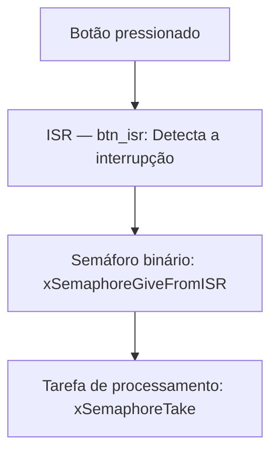

# Lista de Exercícios 02 — Sistemas Embarcados

## Parte A — Interrupções e temporizadores

### Q1. Compare polling e interrupção.

**Polling:** o processador verifica repetidamente se determinado evento aconteceu.

**Interrupção:** o hardware avisa o processador quando determinado evento acontece, sem necessidade de verificar continuamente o estado do dispositivo.

| Critério | Polling | Interrupção |
|---|---|---|
| Latência | Pode chegar ao período de varredura, mais o tempo de execução. | Depende da latência de interrupção e do tempo em que ela fica mascarada. |
| Uso de CPU | Pode consumir CPU verificando continuamente. | Permite que a CPU execute outras tarefas. |
| Complexidade | Mais simples de implementar. | Exige cuidados com ISR e sincronização. |


---

### Q2. Encoder: perda de pulsos e período de polling.

**Dados do exercício:**

- Duração do pulso: 400 µs.
- Frequência máxima: 1 kHz.
- Polling do Lab 3: 10 ms.
- Critério da teoria: período de polling menor ou igual a 1/10 do período do evento.

**Passo 1 — Converter a frequência em período**

Utilizamos:

\[
T = \frac{1}{f}
\]

Substituindo:

\[
T = \frac{1}{1000} = 0,001s = 1ms
\]

Portanto, os pulsos podem ocorrer a cada 1 ms.

**Passo 2 — Comparar com o polling de 10 ms**

O polling verifica o estado do encoder a cada 10 ms.

Isso significa que, entre duas verificações, podem acontecer até 10 períodos de pulsos.

Como cada pulso dura apenas 400 µs, o processador pode não encontrar o sinal em nível ativo durante a leitura.

Assim, vários pulsos podem ser perdidos.

**Passo 3 — Dimensionar o polling**

O critério da teoria é:

\[
T_{polling} \leq \frac{T_{evento}}{10}
\]

\[
T_{polling} \leq \frac{1ms}{10}
\]

\[
T_{polling} \leq 0,1ms = 100\mu s
\]

**Passo 4 — Verificar a duração do pulso**

O pulso dura 400 µs e o polling precisa ocorrer a cada 100 µs ou menos.

Isso oferece aproximadamente quatro verificações durante a duração de um pulso.

**Passo 5 — Conclusão**

Um polling de 100 µs exige 10.000 verificações por segundo, aumentando o uso do processador.

Para essa aplicação, a interrupção é mais adequada.


---

### Q3. As três regras de ouro de uma ISR.

**1. Manter a ISR curta**

Uma ISR deve executar somente as operações essenciais para atender à interrupção.

Exemplo: identificar que um botão foi pressionado e sinalizar uma tarefa.

O processamento mais demorado deve ficar fora da interrupção.

Se a ISR for muito longa, poderá ocupar o processador por muito tempo, atrasando outras interrupções e tarefas.

**2. Não utilizar chamadas bloqueantes**

Uma ISR não deve executar operações que possam bloquear, como esperar indefinidamente por uma fila ou semáforo.

Exemplo de operação inadequada:


### Q4. Dimensionamento do temporizador para 250 ms

**Dados:**
- Clock base: 80 MHz.
- Período desejado: 250 ms.
- Frequência de interrupção: uma a cada 250 ms.

**Passo 1 — Converter o tempo**

250 ms = 0,25 s

**Passo 2 — Calcular a quantidade de ciclos do clock**

Utilizamos:

N = f × T

Substituindo:

N = 80.000.000 × 0,25
N = 20.000.000 ciclos

Precisamos configurar o temporizador para contar 20 milhões de ciclos efetivos.

**Passo 3 — Primeira combinação**

Escolhendo prescaler de 80:

f_timer = 80.000.000 / 80
f_timer = 1.000.000 Hz

O temporizador passa a contar 1 milhão de vezes por segundo.

Para 250 ms:

C = 1.000.000 × 0,25
C = 250.000

**Passo 4 — Segunda combinação**

Escolhendo prescaler de 160:

f_timer = 80.000.000 / 160
f_timer = 500.000 Hz

Agora:

C = 500.000 × 0,25
C = 125.000

**Passo 5 — Qual combinação escolher?**

As duas combinações produzem o mesmo período ideal de 250 ms.

Eu escolheria a primeira, com prescaler 80, por apresentar uma frequência de contagem de 1 MHz, facilitando a interpretação do tempo em microssegundos.

**Resposta:** Para gerar uma interrupção a cada 250 ms, podemos utilizar prescaler 80 e comparação 250.000 ou prescaler 160 e comparação 125.000. A primeira opção é mais simples de interpretar, pois cada contagem corresponde a 1 µs.

**Observação:** O valor de comparação pode exigir ajuste de uma contagem, dependendo da convenção do registrador (contagem até N ou até N−1) e da configuração do temporizador.


### Q5. Watchdog Timer (WDT)

**Passo 1 — O que é um watchdog?**

O Watchdog Timer (WDT) é um temporizador de segurança que monitora se o sistema está funcionando corretamente.

Ele espera receber periodicamente um sinal de alimentação, também chamado de feed ou reset do watchdog.

**Passo 2 — Como funciona?**

1. O sistema inicia o watchdog.
2. Enquanto está funcionando corretamente, realiza a alimentação periódica.
3. Se o programa travar ou deixar de executar corretamente, o watchdog não recebe a alimentação.
4. Quando o tempo limite é atingido, o watchdog pode provocar uma reinicialização ou outra ação de recuperação.

**Passo 3 — Que falha ele evita?**

Ele ajuda a detectar situações como:

- Travamento de tarefas.
- Laços infinitos que impedem o funcionamento normal.
- Bloqueios que impedem a execução de tarefas importantes.
- Falhas que fazem o sistema deixar de responder.

**Passo 4 — Por que alimentar o WDT dentro de uma ISR é um antipadrão?**

Imagine que uma tarefa importante esteja travada, mas uma interrupção de timer continue acontecendo.

Se a ISR alimentar o watchdog, ele continuará acreditando que o sistema está funcionando normalmente, mesmo que a tarefa principal esteja travada.

Isso esconde o problema em vez de resolvê-lo.

**Resposta:** O Watchdog Timer monitora o funcionamento do sistema e identifica situações em que o programa deixa de responder. Quando não recebe alimentação dentro do período determinado, pode reiniciar o sistema. Alimentar o WDT dentro de uma ISR é um antipadrão porque a interrupção pode continuar funcionando mesmo quando as tarefas principais estão travadas, escondendo a falha.


### Q6. Diagrama de estados de uma tarefa

**Passo 1 — Conhecer os quatro estados**

Uma tarefa no FreeRTOS pode estar em quatro estados principais:

1. **Pronta (Ready):** está preparada para executar, aguardando o processador.
2. **Executando (Running):** está utilizando a CPU.
3. **Bloqueada (Blocked):** está aguardando um evento ou período de tempo.
4. **Suspensa (Suspended):** foi suspensa explicitamente e não participa do escalonamento.

**Passo 2 — Entender as transições**

- Executando → Bloqueada: tarefa chama `vTaskDelayUntil()`.
- Bloqueada → Pronta: termina o período de espera.
- Pronta → Executando: escalonador seleciona a tarefa.
- Executando → Pronta: preempção por tarefa de maior prioridade.
- Executando → Suspensa: chamada de `vTaskSuspend()`.
- Suspensa → Pronta: chamada de `vTaskResume()`.

**Passo 3 — Relacionar com o Lab 5**

| Transição | Evento concreto |
|---|---|
| Executando → Bloqueada | Tarefa chama `vTaskDelayUntil()` |
| Bloqueada → Pronta | Termina o período de espera |
| Pronta → Executando | Escalonador seleciona a tarefa |
| Executando → Pronta | Preempção por tarefa de maior prioridade |
| Executando → Suspensa | Chamada de `vTaskSuspend()` |
| Suspensa → Pronta | Chamada de `vTaskResume()` |

**Passo 4 — Exemplo prático**

Imagine uma tarefa que atualiza um LED a cada 100 ms:

    void tarefa_led(void *param) {
        while (1) {
            gpio_set_level(GPIO_NUM_2, 1);

            vTaskDelay(pdMS_TO_TICKS(100));

            gpio_set_level(GPIO_NUM_2, 0);
        }
    }

Quando a tarefa executa `vTaskDelay()`, ela passa para o estado bloqueado. Depois dos 100 ms, volta para o estado pronto.

**Resposta:** Os estados de uma tarefa FreeRTOS são pronta, executando, bloqueada e suspensa. No Lab 5, uma tarefa que chama `vTaskDelayUntil()` passa de executando para bloqueada. Quando o tempo termina, volta para pronta e aguarda o escalonador liberar a CPU.


### Q7. Diferença entre vTaskDelay e vTaskDelayUntil

**Dados do exercício:**
- Período desejado: 100 ms.
- Tempo de execução do corpo: 7 ms.
- Tempo total analisado: 1 minuto.

**Passo 1 — Calcular o período com vTaskDelay()**

A função `vTaskDelay()` espera um tempo relativo ao instante em que é chamada.

Portanto, precisamos somar o tempo de execução do corpo ao tempo de espera.

T_efetivo = T_execução + T_delay

Substituindo:

T_efetivo = 7 + 100
T_efetivo = 107 ms

**Passo 2 — Calcular a deriva acumulada**

A cada ciclo, temos um atraso adicional de 7 ms em relação ao período desejado.

Em um minuto:

N = 60.000 / 100
N = 600 ciclos

Agora calculamos:

D = 600 × 7
D = 4200 ms

Convertendo:

D = 4,2 s

**Passo 3 — Corrigir com vTaskDelayUntil()**

A função `vTaskDelayUntil()` utiliza uma referência temporal absoluta para manter os períodos da tarefa.

Exemplo:

    void tarefa_periodica(void *param) {
        TickType_t ultimo = xTaskGetTickCount();
        const TickType_t periodo = pdMS_TO_TICKS(100);

        while (1) {
            // Executa o trabalho da tarefa

            vTaskDelayUntil(&ultimo, periodo);
        }
    }

**Passo 4 — Comparar as funções**

| Função | Funcionamento |
|---|---|
| `vTaskDelay()` | Espera um tempo relativo após ser chamada. |
| `vTaskDelayUntil()` | Mantém uma referência temporal para os próximos períodos. |

**Resposta:** Com `vTaskDelay(100 ms)`, o período efetivo é de 107 ms, pois são somados os 7 ms de execução e os 100 ms de espera. A deriva teórica em 600 períodos é de 4,2 segundos. Com `vTaskDelayUntil()`, a tarefa mantém uma referência temporal absoluta, evitando o acúmulo dessa deriva, desde que consiga cumprir seus prazos.


### Q8. Prioridades e utilização da CPU

**Dados:**
- Tarefa A: 3 ms de CPU a cada 10 ms.
- Tarefa B: 10 ms de CPU a cada 100 ms.
- Tarefa C: executa quando houver tempo disponível.

**Passo 1 — Calcular a utilização da tarefa A**

A fórmula é:

U = C / T

Onde:
- C = tempo de execução.
- T = período da tarefa.

Substituindo:

U_A = 3 / 10
U_A = 30%

**Passo 2 — Calcular a utilização da tarefa B**

U_B = 10 / 100
U_B = 10%

**Passo 3 — Calcular a utilização total**

U_total = U_A + U_B
U_total = 30% + 10%
U_total = 40%

**Passo 4 — Definir as prioridades**

Uma atribuição adequada seria:

| Tarefa | Prioridade | Motivo |
|---|---|---|
| A | Alta | Possui período menor e resposta mais frequente. |
| B | Média | Possui período maior. |
| C | Baixa | Executa quando houver tempo disponível. |

**Passo 5 — Verificar se C ainda consegue executar**

Se A e B utilizam 40% da CPU, sobra:

100% − 40% = 60%

Portanto, a tarefa C ainda pode utilizar aproximadamente 60% da CPU.

**Passo 6 — E se B passar a utilizar 60 ms a cada 100 ms?**

Novo cálculo:

U_B = 60 / 100
U_B = 60%

U_total = 30% + 60%
U_total = 90%

Agora sobra:

100% − 90% = 10%

A tarefa C ainda consegue executar, mas terá apenas aproximadamente 10% da CPU disponível, considerando um processador ideal sem sobrecargas.

**Resposta:** A tarefa A utiliza 30% da CPU e a tarefa B utiliza 10%, totalizando 40%. Podemos atribuir prioridade alta para A, média para B e baixa para C. Nesse cenário, C dispõe de aproximadamente 60% da CPU. Se B passar a utilizar 60%, o consumo total será de 90%, restando apenas 10% para C.

### Q9. Starvation e time slicing

**Passo 1 — O que é starvation?**

Starvation, ou inanição, acontece quando uma tarefa fica esperando por muito tempo para executar porque outras tarefas ocupam continuamente o processador.

**Passo 2 — Como funciona o time slicing?**

O FreeRTOS utiliza time slicing para dividir o tempo de processamento entre tarefas de mesma prioridade que estejam prontas para executar. Assim, uma tarefa não precisa monopolizar a CPU apenas por ter a mesma prioridade das outras.

**Passo 3 — O que acontece com um while(1) sem bloqueio?**

Imagine:

```c
void tarefa_hog(void *param) {
    while (1) {
        // Processamento contínuo
    }
}
```

Se essa tarefa tiver prioridade alta e nunca bloquear ou ceder a CPU, as tarefas de prioridade inferior poderão deixar de executar.

**Passo 4 — Relação com o watchdog de idle**

O FreeRTOS possui tarefas idle que executam quando não há tarefas de maior prioridade prontas. Se uma tarefa de prioridade alta ocupar continuamente o processador, a tarefa idle pode deixar de executar. Com isso, o watchdog de idle pode identificar o problema e gerar um alerta ou reinicialização.

**Passo 5 — Relação com os laboratórios**

- No Lab 4, o experimento `PROVOCAR_WDT` demonstrou o acionamento do watchdog.
- No Lab 5, a tarefa `HOG` foi utilizada para demonstrar a ocupação excessiva da CPU.

**Resposta:** Starvation acontece quando uma tarefa não consegue obter tempo de CPU porque outras tarefas ocupam continuamente o processador. O time slicing divide o tempo entre tarefas de mesma prioridade, mas não resolve o problema de uma tarefa de prioridade alta que nunca bloqueia. O watchdog de idle ajuda a identificar esse problema quando a tarefa idle deixa de executar.

---

### Q10. Utilização dos dois núcleos do ESP32

**Passo 1 — Entender os dois núcleos**

O ESP32 com dois núcleos permite executar tarefas em processadores diferentes:
- **Core 0:** Wi-Fi e tarefas do sistema.
- **Core 1:** tarefa de controle.

**Passo 2 — Fixar uma tarefa no Core 1**

```c
xTaskCreatePinnedToCore(
    tarefa_controle,
    "Controle",
    2048,
    NULL,
    5,
    NULL,
    1
);
```

O último argumento indica o núcleo em que a tarefa será executada (o valor `1` indica o Core 1).

**Passo 3 — Benefício: redução do jitter**

Jitter é a variação do tempo de execução ou de resposta de uma tarefa. Separar a tarefa de controle das atividades mais pesadas do Wi-Fi pode diminuir a interferência e melhorar a regularidade das respostas.

**Passo 4 — Cuidado: concorrência entre núcleos**

Quando duas tarefas executam em núcleos diferentes, elas podem acessar a mesma variável simultaneamente:

```c
int contador = 0;
```

Se duas tarefas modificarem `contador` ao mesmo tempo, pode ocorrer uma condição de corrida. Por isso, precisamos utilizar mecanismos de sincronização, como mutex, quando apropriado.

**Resposta:** Ao utilizar `xTaskCreatePinnedToCore()`, podemos fixar a tarefa de controle no Core 1 e deixar atividades do sistema e Wi-Fi no Core 0. Isso pode reduzir o jitter e melhorar a previsibilidade da tarefa. Entretanto, é necessário proteger os dados compartilhados, pois os dois núcleos podem executar acessos simultaneamente.

---

## Parte C — Comunicação e sincronização (IPC)

### Q11. Condição de corrida (Race Condition)

**Dados do exercício:**
- Duas tarefas.
- Cada tarefa executa `g++` 1.000 vezes.
- Valor inicial de `g = 0`.

**Passo 1 — Entender o que acontece**

A operação `g++;` parece uma única operação, mas na realidade envolve três etapas:
1. Ler o valor de `g`.
2. Somar 1 ao valor lido.
3. Escrever o novo valor em `g`.

Essas etapas podem ser interrompidas ou intercaladas com as operações de outra tarefa.

**Passo 2 — Exemplo de entrelaçamento**

Imagine que o valor inicial seja `g = 0`:

| Etapa | Tarefa A | Tarefa B | Valor de g |
|---|---|---|---|
| 1 | Lê g = 0 | — | 0 |
| 2 | — | Lê g = 0 | 0 |
| 3 | Calcula 0 + 1 | — | 0 |
| 4 | — | Calcula 0 + 1 | 0 |
| 5 | Escreve 1 | — | 1 |
| 6 | — | Escreve 1 | 1 |

Observe que as duas tarefas realizaram um incremento, mas o resultado final foi apenas 1. Um incremento foi perdido!

**Passo 3 — Calcular o intervalo possível**

Cada tarefa realiza 1.000 incrementos. O resultado ideal seria `g = 2000`. Entretanto, devido às condições de corrida, o menor resultado possível, nesse modelo, é 1.000 (quando as duas tarefas executam seus incrementos em paralelo lógico, perdendo uma atualização em cada par).

```text
1000 ≤ g ≤ 2000
```

**Passo 4 — Primeira solução: utilizar mutex**

O mutex protege a região crítica, impedindo que as duas tarefas modifiquem a variável simultaneamente:

```c
SemaphoreHandle_t mutex;
int g = 0;

void tarefa_A(void *param) {
    for (int i = 0; i < 1000; i++) {
        xSemaphoreTake(mutex, portMAX_DELAY);
        g++;
        xSemaphoreGive(mutex);
    }
    vTaskDelete(NULL);
}
```

A tarefa B deve utilizar a mesma proteção.

**Passo 5 — Segunda solução: variável individual por tarefa**

```c
int contador_A = 0;
int contador_B = 0;

void tarefa_A(void *param) {
    for (int i = 0; i < 1000; i++) {
        contador_A++;
    }
}

void tarefa_B(void *param) {
    for (int i = 0; i < 1000; i++) {
        contador_B++;
    }
}
```

Depois que as tarefas terminarem:

```c
int total = contador_A + contador_B; // Total = 2000
```

**Passo 6 — Quando a segunda solução não serve?**

Essa alternativa é adequada quando precisamos apenas do resultado final. Entretanto, se outras tarefas precisarem consultar o valor total durante a execução e obter uma leitura instantânea consistente, será necessário implementar uma sincronização apropriada.

**Resposta:** A condição de corrida acontece quando duas tarefas acessam e modificam uma variável compartilhada sem proteção. Como `g++` envolve leitura, incremento e escrita, uma tarefa pode sobrescrever o resultado da outra. O valor final pode variar de 1.000 a 2.000. Podemos resolver utilizando mutex ou variáveis individuais por tarefa, somadas posteriormente.

---

### Q12. Comparação entre fila, semáforos, mutex e event group

**Passo 1 — Entender cada mecanismo**

- **Fila (Queue):** permite enviar e receber dados entre tarefas.
- **Semáforo binário:** sinaliza a ocorrência de um evento.
- **Semáforo de contagem:** controla a quantidade de eventos ou recursos disponíveis.
- **Mutex:** protege recursos compartilhados.
- **Event Group:** permite sinalizar vários eventos utilizando bits.

**Passo 2 — Comparação**

| Mecanismo | O que sinaliza ou carrega? | Caso de uso típico | Pode usar ISR? |
|---|---|---|---|
| Fila | Transporta dados ou mensagens | Enviar amostras de sensores para uma tarefa | Sim, com APIs FromISR |
| Semáforo binário | Sinaliza um evento | Avisar uma tarefa que o botão foi pressionado | Sim, com APIs FromISR |
| Semáforo de contagem | Conta eventos ou recursos disponíveis | Contabilizar eventos repetitivos | Sim, com APIs FromISR |
| Mutex | Protege um recurso compartilhado | Proteger uma variável global acessada por tarefas | Não |
| Event Group | Sinaliza vários eventos por bits | Aguardar diferentes condições do sistema | Sim, com API específica FromISR |

**Passo 3 — Cuidados com interrupções**

Não devemos utilizar as APIs comuns de tarefas dentro de uma ISR. Exemplos de versões apropriadas:
- `xQueueSendFromISR()`
- `xSemaphoreGiveFromISR()`
- `xEventGroupSetBitsFromISR()`

No caso de Event Groups, a operação de ISR utiliza um mecanismo de envio para a tarefa daemon de temporizadores, portanto depende também de essa infraestrutura estar disponível. Mutex não deve ser utilizado diretamente dentro de uma ISR.

**Resposta:** Filas transportam dados, semáforos sinalizam eventos ou controlam recursos, mutex protege regiões críticas e Event Groups permitem sinalizar múltiplos eventos por bits. Filas e semáforos possuem versões específicas para ISR, assim como Event Groups possuem uma API própria. Mutex não pode ser utilizado diretamente em interrupções.

---

### Q13. Dimensionamento da fila de amostras

**Dados do exercício:**
- Tamanho de cada amostra: 4 bytes.
- Frequência: 2 kHz.
- Período da tarefa consumidora: 40 ms.
- Folga desejada: 2 vezes.

**Passo 1 — Converter a frequência**

```text
f = 2 kHz = 2000 amostras/s
```

**Passo 2 — Calcular a quantidade de amostras em 40 ms**

```text
40 ms = 0,04 s
N = f × T = 2000 × 0,04 = 80 amostras
```

Portanto, a cada 40 ms são produzidas 80 amostras.

**Passo 3 — Aplicar a folga de 2 vezes**

```text
N_fila = 80 × 2 = 160 itens
```

**Passo 4 — Calcular o tamanho em bytes**

```text
M = 160 × 4 = 640 bytes
```

**Passo 5 — O que acontece se o Wi-Fi ocupar a CPU por 60 ms?**

Durante 60 ms, o produtor continuará enviando amostras, mas a tarefa consumidora pode ficar sem executar:

```text
N = 2000 × 0,06 = 120 amostras
```

Como a fila possui capacidade para 160 itens (`120 < 160`), ela suporta o atraso caso esteja inicialmente vazia.

**Resposta:** A fila deve ter capacidade para 160 itens, ocupando 640 bytes. Durante uma interrupção de 60 ms na execução da tarefa consumidora, serão produzidas 120 amostras. A fila dimensionada consegue armazená-las se houver espaço disponível. Sem capacidade suficiente, ocorrerá estouro da fila e perda de dados.

---

### Q14. Inversão de prioridade e caso Mars Pathfinder

**Passo 1 — O que é inversão de prioridade?**

Inversão de prioridade acontece quando uma tarefa de alta prioridade precisa esperar por um recurso que está sendo utilizado por uma tarefa de baixa prioridade.

**Passo 2 — Exemplo prático**

Imagine três tarefas:
- **Tarefa A:** prioridade alta.
- **Tarefa B:** prioridade média.
- **Tarefa C:** prioridade baixa.

A tarefa C adquire um mutex e começa a utilizar um recurso compartilhado. Em seguida, a tarefa A precisa desse mesmo mutex e precisa esperar. Enquanto isso, B começa a executar e impede que C termine rapidamente. Assim, a tarefa de alta prioridade A fica esperando uma tarefa de baixa prioridade C, enquanto B continua utilizando a CPU.

**Passo 3 — Caso Mars Pathfinder**

O Mars Pathfinder foi uma missão espacial da NASA que apresentou problemas de reinicialização relacionados à inversão de prioridade. Uma tarefa de baixa prioridade mantinha um mutex necessário para uma tarefa de alta prioridade. Uma tarefa de prioridade intermediária impedia que a tarefa de baixa prioridade liberasse o recurso, causando a inversão de prioridade. O problema foi solucionado utilizando herança de prioridade.

**Passo 4 — Como funciona a herança de prioridade?**

O FreeRTOS utiliza herança de prioridade nos mutexes. Quando uma tarefa de alta prioridade fica esperando por um mutex que pertence a uma tarefa de baixa prioridade, a tarefa que possui o mutex pode herdar temporariamente a prioridade mais alta. Assim, ela consegue executar e liberar o recurso mais rapidamente. Depois de liberar o mutex, sua prioridade retorna ao valor original.

**Passo 5 — Por que o semáforo binário não resolve?**

O semáforo binário não possui a mesma relação de propriedade que um mutex. Por isso, não oferece o mecanismo de herança de prioridade.

**Resposta:** Inversão de prioridade acontece quando uma tarefa de alta prioridade fica esperando por um recurso utilizado por uma tarefa de baixa prioridade. No caso Mars Pathfinder, uma tarefa de prioridade intermediária impedia que a tarefa de baixa prioridade liberasse o mutex necessário à tarefa de alta prioridade, provocando reinicializações. O mutex do FreeRTOS utiliza herança de prioridade para permitir que a tarefa que possui o recurso execute com prioridade temporariamente elevada. O semáforo binário não oferece esse mecanismo.

---

### Q15. Comunicação entre ISR e tarefa utilizando semáforo binário

**Passo 1 — Entender o funcionamento**

Quando um botão é pressionado, ocorre uma interrupção. A ISR identifica o evento e envia um sinal para uma tarefa utilizando um semáforo binário. A tarefa recebe esse sinal e realiza o processamento.



**Passo 2 — Criar o semáforo**

```c
SemaphoreHandle_t btn_semaforo;

void app_main(void) {
    btn_semaforo = xSemaphoreCreateBinary();
    // Configuração do GPIO e da interrupção
}
```

**Passo 3 — Criar a ISR**

```c
void IRAM_ATTR btn_isr(void *arg) {
    BaseType_t tarefa_acordada = pdFALSE;
    xSemaphoreGiveFromISR(
        btn_semaforo,
        &tarefa_acordada
    );
    if (tarefa_acordada == pdTRUE) {
        portYIELD_FROM_ISR();
    }
}
```

A função `xSemaphoreGiveFromISR()` envia o sinal sem bloquear a interrupção. Já `portYIELD_FROM_ISR()` permite solicitar a troca de contexto quando uma tarefa de maior prioridade foi acordada.

**Passo 4 — Criar a tarefa de processamento**

```c
void tarefa_botao(void *param) {
    while (1) {
        if (xSemaphoreTake(
            btn_semaforo,
            portMAX_DELAY
        ) == pdTRUE) {
            // Processamento do botão
            printf("Botao pressionado!\n");
        }
    }
}
```

A tarefa fica bloqueada esperando o semáforo. Quando a ISR envia o sinal, a tarefa é liberada para executar.

**Passo 5 — Por que deixar o processamento pesado na tarefa?**

Porque uma ISR deve executar rapidamente. Se colocarmos operações demoradas dentro dela, podemos atrasar outras interrupções e prejudicar o funcionamento do sistema. A tarefa permite realizar operações como:
- Atualizar informações.
- Processar dados.
- Enviar mensagens.
- Executar cálculos.
- Utilizar funções que podem bloquear.

**Resposta:** O padrão ISR→tarefa utiliza `xSemaphoreGiveFromISR()` para sinalizar que o botão foi pressionado e `xSemaphoreTake()` para a tarefa receber o evento. A função `portYIELD_FROM_ISR()` permite solicitar uma troca de contexto quando necessário. O processamento pesado deve ficar na tarefa porque a ISR precisa ser curta e não pode executar operações bloqueantes.
